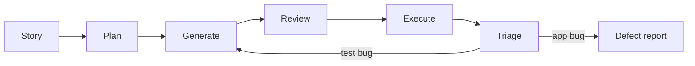

# QA Mart Testing Plugin

A GitHub Copilot plugin for planning, generating, reviewing and triaging Playwright + TypeScript tests for the QA Mart e-commerce application.

## Overview

QA Mart is a small shop with login, a product catalog, a cart, checkout and coupon validation. This plugin gives Copilot the context and guardrails to test it consistently:

- **Instructions** that set locator, assertion and Page Object rules (prefer `data-testid`, no `page.waitForTimeout()`).
- **Prompts** that generate test cases and specs per flow.
- **Skills** for coupon boundaries, failure analysis and test data.
- **Agents** that cover the test lifecycle from story to defect report.
- **Hooks** that keep agents out of application code and check generated tests.
- **An MCP server** that lets agents read the repository.

| | |
|---|---|
| Application | QA Mart, `http://localhost:3000` (`npm start`) |
| Framework | Playwright + TypeScript, Page Object Model |
| Areas | Login, Product Catalog, Cart, Checkout, Coupon Validation |
| Design versions | v1 (default) and v2 redesign (`npm run test:v2`) |

## Features

- **Test Planning**: reviews stories, ranks risks, builds a test strategy and writes manual scenarios.
- **Test Generation**: writes Playwright specs, Page Objects and fixtures that follow the project conventions.
- **Test Review**: finds flaky behavior, weak locators and weak assertions, and checks expected values against the story.
- **Bug Triage**: classifies failures as App Bug, Test Bug, Test Data Issue or Environment Issue and drafts the defect report.
- **Coupon Boundary Testing**: boundary, eligibility, reuse, invalid and expired cases for FLAT100, WELCOME50 and SAVE10.
- **Failure Analysis**: classifies failures as App Bug, Automation Defect, Data Issue, Environment Issue or Flaky Test from traces, screenshots and stack traces.

## Folder Structure

```
qamart-testing-plugin/
├── plugin.json        Manifest: metadata, capabilities and references to every component
├── README.md
├── instructions/      Always-on and file-scoped rules for Copilot
├── prompts/           Reusable prompt files, one per flow plus a bug report
├── skills/            Skills, one folder each with a SKILL.md
├── agents/            Custom agents for each stage of testing
├── mcp/               MCP server configuration
├── hooks/             Hook registration and the Node.js (CommonJS) hook scripts
└── templates/         Test case and bug report formats used by prompts and agents
```

| Folder | Contents |
|---|---|
| `instructions/` | `copilot-instructions.md` (global), `specs.instructions.md` (applies to `tests/**/*.spec.ts`), `page-objects.instructions.md` (applies to `pages/**/*.ts`) |
| `prompts/` | `login-tests`, `product-search-tests`, `add-to-cart-tests`, `checkout-tests`, `bug-report` |
| `skills/` | `playwright-failure-analysis`, `coupon-boundary-testing`, `test-data-design` |
| `agents/` | `test-planner`, `test-generator`, `test-reviewer`, `bug-triage` |
| `mcp/` | `mcp.json` with the filesystem server and QA Mart context |
| `hooks/` | `hooks.json`, `guard-app.cjs`, `post-edit-checks.cjs`, `log-tool.cjs` |
| `templates/` | `test-case.md`, `bug-report.md` |

## Installation

Prerequisites: Node.js 20 or newer, the QA Mart repository with dependencies installed (`npm install`), and VS Code with GitHub Copilot Chat.

Quick install (Copilot CLI), from the repository root:

```powershell
copilot plugin install ./qamart-testing-plugin
```

Or install from GitHub after pushing the repo: `copilot plugin install <owner>/<repo>:qamart-testing-plugin`.

1. In VS Code, enable plugins and register this folder in your user settings (both settings are experimental). Use the absolute path of your clone:

   ```json
   {
     "chat.plugins.enabled": true,
     "chat.pluginLocations": {
       "C:/path/to/qa-mart-lab/qamart-testing-plugin": true
     }
   }
   ```

2. Reload VS Code, then check:
   - Extensions, `@agentPlugins`, Installed: `qamart-testing-plugin` is listed.
   - Chat, Open Customizations: the skills, agents and hooks appear.
   - Command Palette, **MCP: List Servers**: `qamart-filesystem` is running.

3. Instructions and prompt files are not plugin components in some Copilot versions. If `/login-tests` or the instruction rules do not appear, copy them into the repository:

   ```powershell
   Copy-Item qamart-testing-plugin/instructions/*.md .github/instructions/ -Force
   Copy-Item qamart-testing-plugin/prompts/*.md .github/prompts/ -Force
   ```

   Rename `copilot-instructions.md` and place it at `.github/copilot-instructions.md`.

4. Start the application before running tests: `npm start`.

Plugin hooks and MCP servers run code on your machine without a trust prompt. Read the scripts in `hooks/` before enabling the plugin.

## Usage

Select a prompt from Copilot Chat by typing its name with `/`. Each prompt asks for its inputs, reads the story and the app, writes files under `tests/lab/` and `pages/`, and runs the checks.

### Login
```
/login-tests
Scope: US-104 sign-in
```
Covers valid sign in, wrong password, unknown email, empty fields, the locked account (HTTP 423) and the signed-out redirect to `/login`.

### Product Catalog
```
/product-search-tests
Scope: product list and search
```
QA Mart has no search control yet, so the prompt reports it as a gap with suggested test ids and tests what exists: product cards, prices, "Out of stock" for Laptop Stand and API-to-UI consistency.

### Add To Cart
```
/add-to-cart-tests
Scope: US-103 stock limits
```
Covers adding items, the same item twice, `cart-count`, `cart-subtotal`, removal, the empty cart and out-of-stock products.

### Checkout
```
/checkout-tests
Scope: US-101 coupons and US-106 delivery details
Coupons to cover: FLAT100, WELCOME50
```
Covers delivery validation (10-digit mobile, 6-digit PIN), coupon amounts, totals, order confirmation and the order API. Payment and tax are not in the app and are listed as gaps.

## Available Agents

| Agent | File | Role |
|---|---|---|
| QA Mart Test Planner | `agents/test-planner.agent.md` | Reviews stories, identifies risks, writes the strategy and manual scenarios. Read-only. |
| QA Mart Test Generator | `agents/test-generator.agent.md` | Writes Playwright specs, Page Objects and fixtures, runs them and reports failures. |
| QA Mart Test Reviewer | `agents/test-reviewer.agent.md` | Reviews tests for flakiness, locators and assertions, and returns a verdict. Read-only. |
| QA Mart Bug Triage | `agents/bug-triage.agent.md` | Classifies failures, recommends the next action and drafts the defect report. |

## Available Skills

| Skill | Purpose |
|---|---|
| `playwright-failure-analysis` | Classifies failures into App Bug, Automation Defect, Data Issue, Environment Issue or Flaky Test, with evidence and confidence. |
| `coupon-boundary-testing` | Produces boundary and eligibility tables for FLAT100 (₹500), WELCOME50 (₹250 cap, first order) and SAVE10 (₹200 cap), plus invalid and expired codes. |
| `test-data-design` | Produces valid and invalid users, product combinations, coupon datasets and boundary datasets for `tests/test-data.ts`. |

## Available Prompts

| Prompt | Command | Output |
|---|---|---|
| `login-tests.prompt.md` | `/login-tests` | Login test cases, `LoginPage`, `tests/lab/login.spec.ts` |
| `product-search-tests.prompt.md` | `/product-search-tests` | Catalog and search cases, `ProductsPage`, `tests/lab/product-search.spec.ts` |
| `add-to-cart-tests.prompt.md` | `/add-to-cart-tests` | Cart cases, `CartPage`, `tests/lab/add-to-cart.spec.ts` |
| `checkout-tests.prompt.md` | `/checkout-tests` | Checkout cases, `CheckoutPage`, `ConfirmationPage`, `tests/lab/checkout.spec.ts` |
| `bug-report.prompt.md` | `/bug-report` | A structured defect report from a failed test run |

## MCP Server

`mcp/mcp.json` registers `qamart-filesystem`, the official filesystem MCP server (`@modelcontextprotocol/server-filesystem`), started with `npx`.

- **Scope:** the server is given only `${workspaceFolder}`, so agents, prompts and skills can read QA Mart files (`tests/`, `pages/`, `docs/stories/`, `app/`) and nothing outside the repository.
- **Write access:** the filesystem server can also write inside that folder. The guard hook is what keeps agents out of application code.
- **Context:** the `qamartContext` block records the application name, base URL (`http://localhost:3000`), the Playwright + TypeScript commands and the key paths, so agents and scripts share one source of truth. It is a plugin-specific block and is not part of the MCP server schema.

## Hooks

Registered in `hooks/hooks.json`. All scripts are Node.js CommonJS and read the tool event as JSON on stdin.

| Hook | Event | Behavior |
|---|---|---|
| `guard-app.cjs` | before edit, create or patch | Allows edits only under `tests/`, `pages/` and `qamart-testing-plugin/`. Denies `app/`, `src/` and `public/` with a message, and denies paths outside the allowed folders. |
| `post-edit-checks.cjs` | after edit, create or patch | Warns with `file:line` about `waitForTimeout`, tests without `expect`, CSS selectors where `getByTestId` fits, and XPath. Never blocks. |
| `log-tool.cjs` | after every tool call | Appends timestamp, tool, agent, action and result as JSON lines to `hooks/qamart-plugin.log`. Argument values are never logged. |

Set `QAMART_PLUGIN_LOG` to write the log outside the plugin folder. Add the log file to `.gitignore`.

## Example Workflow



1. **Story**: pick `US-101` (coupon at checkout).
2. **Plan**: the Test Planner reads the story and returns risks and scenarios, for example FLAT100 at ₹499, ₹500 and ₹501 and WELCOME50 on a first versus a returning order.
3. **Generate**: the Test Generator writes `pages/CheckoutPage.ts` and `tests/lab/checkout.spec.ts`.
4. **Review**: the Test Reviewer checks locators, waits and that expected totals match the story (₹400 for FLAT100 at ₹500).
5. **Execute**: run `npx playwright test tests/lab/checkout.spec.ts`.
6. **Triage**: Bug Triage classifies each failure. The FLAT100 test at ₹500 fails because the app uses `subtotal > 500`, so it is an App Bug, and the report is drafted from `templates/bug-report.md`.

## Demo Commands

Run the application and the tests:

```powershell
npm start
npx playwright test tests/lab/checkout.spec.ts
npx playwright test tests/lab/checkout.spec.ts -g "FLAT100" --repeat-each=3
npm run test:v2
npm run typecheck
npm run lint:specs
```

Check generated code with the plugin's validation hook:

```powershell
node qamart-testing-plugin/hooks/post-edit-checks.cjs tests/lab/checkout.spec.ts pages/CheckoutPage.ts
```

Confirm the guard blocks application edits and allows test edits:

```powershell
'{"toolName":"edit","toolArgs":{"filePath":"app/server.js"}}' | node qamart-testing-plugin/hooks/guard-app.cjs
'{"toolName":"edit","toolArgs":{"filePath":"tests/lab/checkout.spec.ts"}}' | node qamart-testing-plugin/hooks/guard-app.cjs
```

Read the tool log:

```powershell
Get-Content qamart-testing-plugin/hooks/qamart-plugin.log -Tail 5
```

Example chat requests:

```
Use the QA Mart Test Planner to plan US-101. Rank risks for FLAT100 and WELCOME50.
Use the QA Mart Test Generator to automate TC-CHECKOUT-001 and TC-CHECKOUT-003.
Use the QA Mart Test Reviewer to review tests/lab/checkout.spec.ts.
Use QA Mart Bug Triage on the failing FLAT100 test. Trace: test-results/<test-folder>/trace.zip
```

## 60-Second Demo

1. `npm start`, then in chat run `/login-tests` with scope `US-104 sign-in`.
2. The generated [tests/lab/login.spec.ts](../tests/lab/login.spec.ts) passes: `npx playwright test tests/lab/login.spec.ts` (4 passed).

## Known Limits

- QA Mart has no search control, payment step or tax calculation. The prompts report these as gaps and do not generate executable tests for them.
- The lab app contains intentional defects: FLAT100 is rejected at exactly ₹500, and WELCOME50 stays valid after a first order. Tests written from the stories are expected to fail on them.
- Order state is shared in memory. Run order-placing tests with one worker and call `POST /api/test/reset` first.
